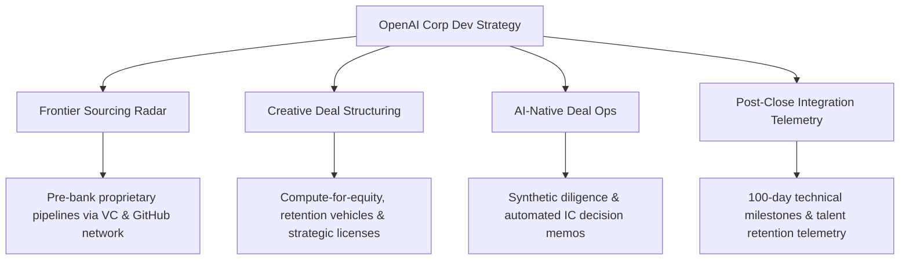
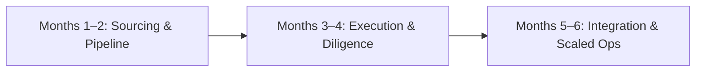

# 🧭 OpenAI Corporate Development Strategy Brief: Inorganic Growth & AI-Native Deal Operations

**Role:** Corporate Development, Deal Lead  
**Author:** Pavel Cherkashin (`pavel@mindrock.capital`)  
**Context:** OpenAI Corporate Development & Inorganic Growth Strategy  
**Linear Issue:** `MIN-209`  

---

## 1. Executive Summary & Corporate Development Mandate

OpenAI operates at the frontier of artificial general intelligence. To sustain that leadership, OpenAI's corporate development strategy must execute inorganic moves with unparalleled speed, strategic foresight, and transactional rigor.

The **Corporate Development, Deal Lead** drives high-priority M&A, minority investments, compute alliances, and strategic joint ventures that:
1. **Accelerate Research Frontiers:** Acquiring breakthrough talent clusters and novel model architectures before they diffuse across the open market.
2. **Fortify Vertical Ecosystems:** Securing critical platform layers, developer tooling, data pipelines, and infrastructure partnerships.
3. **Pioneer AI-Native Deal Ops:** Modernizing the traditional investment banking and corporate development playbook with autonomous multi-agent intelligence systems.

---

## 2. Core Strategic Pillars

### Pillar 1: Proprietary Deal Origination
* **Venture-Driven Sourcing:** Leveraging 20+ years of top-tier VC and founder relationships to engage target founders well before formal auction processes begin.
* **Preprint & Open-Source Telemetry:** Tracking breakthrough research papers, arXiv preprints, GitHub star velocity, and model benchmark trajectories to anticipate strategic acquihire and tech acquisition targets.

### Pillar 2: Creative Transaction Architecture
* **Non-Standard Commercial Currency:** Structuring multi-asset transactions combining cash, equity, compute commitments (API tokens / cluster access), and joint commercialization rights.
* **Founder Alignment & Retention:** Designing retention structures that motivate elite researchers and systems engineers inside OpenAI's unique mission-driven governance framework.

### Pillar 3: AI-Native Deal Operations
* **Automated Diligence Pipelines:** Deploying agent networks to execute automated codebase audits, dependency vulnerability scans, license provenance checks, and cap-table scenario modeling.
* **Dynamic Investment Committee Materials:** Synthesizing comprehensive deal memos, risk matrices, and valuation benchmarks in hours rather than weeks.

---

## 3. The 6-Month Corporate Development Execution Arc

### Months 1–2: Sourcing Radar & Strategic Alignment
* Collaborate with Sam Altman, Brad Lightcap, Research Leads, and VP Engineering to map high-priority inorganic gaps across inference optimization, agentic frameworks, and vertical solutions.
* Deploy automated scouting infrastructure across global venture deals and developer repositories.
* Calibrate financial valuation ranges and antitrust/regulatory parameters with OpenAI Legal and Finance.

### Months 3–4: Transaction Structuring & Execution
* Lead 2–3 live transactions through letter of intent (LOI), definitive documentation, and closing.
* Direct cross-functional diligence teams spanning Research, Legal, Accounting, Tax, and People teams.
* Author executive-ready decision materials and manage board-level approvals.

### Months 5–6: Integration Playbooks & Organizational Scale
* Institutionalize a standardized 100-day post-close integration framework focused on technical velocity and cultural alignment.
* Scale Corp Dev infrastructure to support concurrent multi-track transactions without compromising diligence rigor.

---

## 4. Conclusion
By uniting deep venture capital experience, a historic landmark enterprise deal record, and proprietary AI-native deal operations, this application package positions Pavel Cherkashin as an immediate high-impact Deal Lead for OpenAI Corporate Development.
