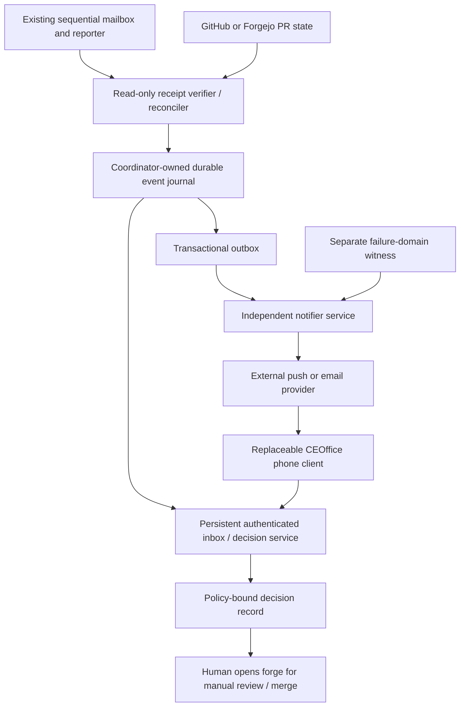

# CEOffice decision inbox specification v1

Status: proposal for manual review; specification only. Prepared 2026-09-05 UTC for [source issue #50](https://github.com/pashamango/minutta-rp-pr-cycle-lab/issues/50). Normative MUST/SHOULD statements below are proposed implementation requirements, not claims of installed capability or authority for this run. No application, enrollment, push, authentication, merge or deployment is performed.

## 1. Evidence and scope

Policy baseline is merged main `65a40e06a340b64b1ce060265a79ce1ba50fcb77`: [runbook](../../../CHATGPT-MAILBOX-RUNBOOK.md), [template](../../../templates/mailbox-task-v1.md), [repository policy](../../../config/wolfram-agent-mailbox-policy.yaml). Installed mailbox policy restricts the repository to `pashamango/minutta-rp-pr-cycle-lab`; installed reporter source was inspected read-only. No applicable AGENTS.md was found in the worktree or inspected ancestor directories. The executor remains sequential. CEOffice is an independent design workstream, not a second worker or a dependency on obtaining Darwin access.

Live GitHub API observation on 2026-09-05 at approximately 21:04 UTC:

- [Issue #48](https://github.com/pashamango/minutta-rp-pr-cycle-lab/issues/48) has CLAIMED, [EXECUTION_FINISHED](https://github.com/pashamango/minutta-rp-pr-cycle-lab/issues/48#issuecomment-5554751377) (exit 0, finished 21:00:36.049997Z), and [TASK_BLOCKED](https://github.com/pashamango/minutta-rp-pr-cycle-lab/issues/48#issuecomment-5554751621) receipts. Bindings agree: lease `d48a651cf24c427782210bda10708338`, source digest `67e693e5d875ef33cd1d36e6814df8cab217dfaf941eb884753b616a008ce3f9`. Outcome digest is `e2f94907b198af9bc9f68e79eb0c101cbf9d979016c3165e8a56a2a0a2ae077d`; published validation is `pr:49:repository_branch_base`.
- [PR #49](https://github.com/pashamango/minutta-rp-pr-cycle-lab/pull/49) is OPEN, draft, base main, head `880483debc8f601a7b16cc6731eb24de7a66aed0`. Its body reports CLI 0.153.4, gpt-6-astra, reasoning effort low, and timed-out established SSH routes. These are prior-run reported observations, not a fresh CLI/host measurement here. Timeout does not identify a failed component. Darwin health remains unknown; this task does not diagnose it or enable Remote Login.
- PR author and repository owner are both pashamango. No mobile delivery evidence was found in the inspected issue/PR. No self-review request is appropriate. Receipts contain counts and hashes, not raw result summaries; a notifier cannot recover a summary from a hash.

A receipt proves only what its validation covers. Existing reporter validates admission/source/claim/lease/result and PR repository/branch/base, not semantic correctness, phone display, or a permanently fixed PR head. Same-account GitHub text is not independently signed machine evidence. The future local adapter MUST verify against trusted local records where available; GitHub-only observations remain explicitly limited. This document makes no A2A/MCP interoperability claim: future adapters need a separate version-pinned protocol review; no installed A2A/MCP notification capability is assumed.

## 2. Architecture and authority



Journal, inbox and outbox belong to coordinator infrastructure, not a browser tab, phone, ChatGPT conversation or five-task cloud scheduler. Deployment host is not yet selected; Darwin is a candidate, not a verified operational service. Notifier has its own lifecycle and durable cursor, and can retry when the task executor is idle or gone. This is a future service boundary, not permission to change current mailbox scheduling/concurrency. A notifier on the same powerless host cannot alert; coordinator outage detection requires a separately powered, independently connected witness and a reachable channel.

Proposed transaction: validate source -> append immutable event and outbox row atomically -> acknowledge ingestion. A crash before commit leaves nothing acknowledged; crash after commit permits duplicate submission but not lost journal history. Unique event/idempotency indexes enforce convergence. Polling reconciler (default every 60 seconds, overlapping previous 10 minutes plus daily full bound-task scan) recovers missed receipts and PR changes; it advances its cursor only after commit. A single writer assigns a journal sequence; source timestamps are not total ordering. Corrections append superseding observations; never rewrite old evidence. Proposed retention: events/decisions 365 days, delivery attempts 30 days, reviewed deletion/backup policy; no raw logs or indefinite device tracking. Restore must preserve deduplication and nonce-consumption records.

Trust boundaries: executor output is untrusted content; verifier alone maps allowlisted evidence to events. Notifier can read sanitized outbox data and delivery subscriptions, not approve or execute actions. Client may request reads/decisions but cannot set authoritative task/review states. Provider sees minimal payload/traffic metadata and holds delivery availability power; it receives no approval credential. Inbox service enforces owner/account ACLs on every object. Source fetches must use exact allowlisted repository/object routes with bounded size/time and no arbitrary URL redirects; evidence links are not commands. Render source prose as escaped text or strictly sanitized Markdown.

## 3. Event contract and reconciliation

[notification-event.schema.json](notification-event.schema.json) defines `ceoffice.notification-event/v1`, JSON Schema draft 2020-12. [examples.json](examples.json) is an array of entirely synthetic events, including execution, blocked, review, completion and delivery observations. Events stay server-side. Push payload projection is only a generic title (`CEOffice update`), category, opaque event ID and fixed same-origin inbox route; maximum proposed payload 512 UTF-8 bytes. No full event, raw prompts, logs, secrets, task titles by default, subscription endpoints, or bearer approval links on the lock screen.

Required bindings: task ID, lease and positive attempt number, admitted source digest, authenticated producer identity, source occurrence time, verifier observation time, event type, severity, evidence/result references, expiry and idempotency. Producer identity is a registry lookup tied to an authenticated ingestion principal, never trusted because the JSON says so. Evidence verification enum distinguishes bound local receipt, forge snapshot, client assertion and unverified input. Unverified input may be quarantined but MUST NOT generate a normal actionable card/push. Schema validation alone establishes neither authenticity nor truth.

Idempotency v1: `sha256:` plus SHA-256 of UTF-8 compact JSON array `[protocol,task_id,lease_id,source_sha256,event_type,source_record_id]`. All six strings are restricted to ASCII by schema; serialize without whitespace. `source_record_id` identifies a durable immutable receipt/snapshot/ack revision, not just the mutable PR number. Its reuse with different content is quarantined. The unique key includes the lease, so explicit new attempts are separate. Delivery retry reuses the originating outbox key and does not mint a new task event. A delivery observation is a distinct journal event whose `related_event_id` points to the source event. Its idempotency uses the immutable delivery record ID. Producer namespace is pinned per task adapter so another producer cannot capture an existing key.

Schema cannot enforce hash computation, temporal ordering, relationship existence, principal authenticity or transition legality. Runtime MUST additionally enforce: occurred_at <= observed_at + 120 seconds (otherwise clock-skew quarantine); expires_at > occurred_at; decision/action expiry is checked using server time; immutable event ID/key uniqueness; same ID/key plus differing bytes is a conflict. Expired events remain evidence but cannot submit fresh push or approve. Evidence content SHA-256 is verified when bytes are accessible; absent digest or inaccessible bytes stays a visible limit. References are opaque private evidence IDs or HTTPS links with query/fragment/userinfo prohibited by application validation; never fetch an arbitrary reference automatically.

Task reconciliation groups by `(task_id, lease_id, source_sha256)`. Match source admission, receipt state/key and outcome digest to local reporter records; verify counts/bindings and current forge state separately. Missing terminal receipt after process exit is `outcome unknown`, not completion. TASK_COMPLETED means a bound agent assertion with listed deterministic validations; the UI exposes their scope. Conflicting terminal receipts freeze that dimension pending investigation. A PR snapshot must carry number, repository, head commit, base, draft/open/review/merge observation and server observation time. Re-fetch head and policy at decision time. A changed head creates a new review revision and expires previous approval intent, while preserving its history. Reconciliation never reruns a task or changes a mailbox claim.

Proposed adapter operations (not installed endpoints): `ingestVerifiedEvent(event, principal)` commits once; `listInbox(cursor)` returns ACL-filtered projections plus source freshness; `recordRead(event_id)` records an explicit authenticated acknowledgement; `beginDecision(decision_id, revision)` issues a bound challenge; `recordDecision(assertion)` validates/consumes it atomically. Pagination cursor is opaque and account-scoped. No API accepts arbitrary commands or forge merge requests.

## 4. Independent state machines

Each dimension supports `unknown` projection when evidence is missing; unknown is not an invented event or a successful state. Historical observations are append-only.

| Dimension | Allowed progression and evidence |
| --- | --- |
| Execution per lease | unknown -> claimed -> one of execution_finished / execution_failed / timed_out. A late claimed receipt fills history without regressing a terminal projection. Contradictory terminal observations flag conflict. |
| Task outcome per lease | unknown -> task_completed / task_blocked / task_failed, only from a bound outcome receipt. Current reporter emits these after normal process exit; failed/timed-out process alone leaves outcome unknown. A blocked lease stays blocked; any authorized retry is a new lease/task admission, never notification retry. |
| Review per PR head | unknown -> draft or ready_for_review; draft <-> ready_for_review; ready_for_review -> approved or rejected based on authorized forge review; approved/rejected -> ready_for_review on head change or renewed review. Merged is recorded only from forge merge evidence; closure without merge is a separate closed observation. Manual merge can occur without this UI approving; preserve that fact rather than inventing an approval. Merge != deployment. |
| Delivery per event/channel/subscription | persisted -> submitted -> provider_accepted, or retry_pending / delivery_failed; deadline -> expired; retry budget exhaustion -> dead_letter. Timeout after submission means provider acceptance unknown. client_observed, human_read and decision_recorded are separately evidenced milestones and may arrive with intermediate milestones unknown (e.g. direct inbox visit). |

`provider_accepted` is a response, not proof of display. `client_observed` means an authenticated client reports receipt/handling; it does not prove OS lock-screen presentation. `human_read` is explicit acknowledgement, not proof of comprehension; GitHub read sync is not CEOffice read evidence. `decision_recorded` requires a validated exact decision, never an open/read/push click. A decision can be rejected and still be recorded. App closed and no client telemetry leaves visibility unknown. Display each dimension and evidence age, not a single misleading green check.

## 5. Escalation and delivery policy

Defaults below are proposed, configurable, versioned and audited. Owner opt-out disables a channel, not the underlying safety event or visible warning. A classifier can add discovery interest but cannot suppress deterministic safety rules.

| Event / rule | Default route and timing | Explanation / override |
| --- | --- | --- |
| Verified critical security or availability failure | Submit immediately on enabled capable channels; persistent red inbox banner | Deterministic rule wins ranking/quiet-hour batching. OS Focus/permissions may still suppress display; no Apple Critical Alerts entitlement asserted. |
| task_blocked requiring owner action | Actionable notification within 60 seconds outside quiet hours; Blocked section | Show concrete owner action and unknown cause. Repeated same blocker grouped, one reminder next working day. |
| ready_for_review for a new PR head | Actionable notification within 60 seconds outside quiet hours | Include private evidence/review link after authentication; never self-review request. |
| ordinary task_completed or execution_finished | Daily 18:00 local digest | Execution-only result explicitly says outcome unknown. Digest does not promote it to completed. |
| Discovery / interesting proposal | Digest; at most 3 ranked cards/day by default | Explain topic match, novelty and estimated relevance; user can tune topics, threshold and hide interest-only cards. Ranking is preference, not calibrated probability. |
| Stale producer / outbox / witness | Warning after 3 missed 60-second heartbeats; critical after 10 minutes if independent evidence supports it | Say “last observed” and suspected reachability loss, never diagnose power failure from silence. |

Quiet hours default 22:00–08:00 America/Los_Angeles, evaluated with timezone/DST rules. Noncritical events batch by task and current review revision, maximum 20 cards per digest with remainder in inbox. Deduplicate identical event keys indefinitely within retained history; preserve tombstones through retry retention. Related events may coalesce wake hints but never discard journal entries. Cap noncritical actionable pushes at 5/hour/subscription and expose delayed counts. Security storms coalesce per incident for 5 minutes with severity increases breaking coalescing; never silently drop distinct critical incidents. Policy changes require explicit owner review, including safety threshold changes.

Proposed delivery attempts: immediate, then exponential waits 30s, 2m, 10m, 30m, 2h (six total attempts), with full jitter and provider Retry-After respected up to expiry. Transient network/429/5xx retries; invalid payload/auth pauses to operator-visible dead letter; revoked/expired subscriptions disable that subscription, no re-enrollment loop. Unknown acceptance can cause duplicate wake hints; stable event ID collapses client cards. Expiry defaults: critical 1h, action hint 24h, digest 24h; unresolved decision remains in inbox with its own deadline. Retry applies only to delivery, never task execution. Before each retry reconcile whether action was resolved/superseded. Stop on resolution, revocation, expiry or budget. Dead letters include sanitized reason, attempts and next operator action; owner-authorized resubmission checks current state first.

No client ack after 24h is “client observation unavailable/stale,” not “phone offline.” Provider outage leaves durable pending inbox entries, backoff and last-success age. Independently witnessed coordinator loss is an alert from the witness, not the failed coordinator; witness and notifier common-mode power/network failure remains a coverage gap.

## 6. Transport decision record

Decision ADR-01: transitional GitHub Mobile plus optional email; target Home Screen web app with standards-based Web Push; defer native iOS.

GitHub Mobile is the phone application, whereas a GitHub App is a service identity/integration requiring separate registration and authorization. Existing receipts/PRs give a persistent transitional place to inspect work. Mobile push supports selected categories (mentions, assignments, review/deployment requests); watching a PR does not establish push. Same-actor updates are not a dependable push trigger. GitHub offers an own-update **email** setting, but that does not prove Mobile push. No mentions, assignments, self-review tricks or service identity registration are authorized here. One-time later setup: owner signs into Mobile, chooses subscriptions/OS notification settings and optionally verified email/own-update email; then measures delivery. Until proven, use explicit phone inbox inspection and label automated phone escalation unavailable. [GitHub notification documentation, retrieved 2026-09-05](https://docs.github.com/en/subscriptions-and-notifications/get-started/configuring-notifications).

For future Home Screen enrollment, owner opens the stable HTTPS tailnet origin, installs via Add to Home Screen, signs in, and explicitly taps Enable notifications. iOS/iPadOS 16.4+ Home Screen Web Push requires permission following user interaction; support is feature-detected on the actual phone. Apple Developer Program membership is unnecessary for Web Push. Focus may affect visibility. [WebKit, 2023-02-16](https://webkit.org/blog/13878/web-push-for-web-apps-on-ios-and-ipados/).

The server stores each account's encrypted-at-rest subscription; service worker displays generic notifications without first fetching private content. Invisible background polling via push is not supported in Safari. Use a maintained standards library for VAPID/payload encryption, outbound provider HTTPS and bounded TTL. Never publish endpoint/auth material. [Apple Web Push documentation, retrieved 2026-09-05](https://developer.apple.com/documentation/usernotifications/sending-web-push-notifications-in-web-apps-and-browsers) (Markdown representation retrieved directly because the initial documentation page required JavaScript). Transport lifetimes and acknowledgements follow [RFC 8030, December 2016](https://www.rfc-editor.org/rfc/rfc8030); application observation remains distinct from transport acceptance.

Tailnet-only origin means inbox, evidence and authorization require authorized private connectivity. With Tailscale off but ordinary internet on, an already enrolled phone **may** receive a generic provider push; opening protected content requires restoring Tailscale and authenticating. This is a design expectation requiring an end-to-end device test, not a demonstrated result. Do not expose Darwin or Forgejo publicly. Cached shell may explain connectivity but cannot cache actionable private evidence by default or approve offline. No incoming provider webhook is needed for this design.

Dependencies/costs: GitHub availability/account/settings and email provider filtering; internet and Apple/browser push service; HTTPS naming/certificate renewal, tailnet access, coordinator storage/operations and independent witness. No exact operating cost has been measured; no subscriptions purchased. Native iOS may later be justified by demonstrated accessibility or platform-integration gaps, not by an assumption of guaranteed delivery. It adds APNs credential, signing, distribution and maintenance obligations and potentially paid program membership; pricing/distribution choice must be checked before that separate approval. The current [Apple account overview](https://developer.apple.com/help/account/basics/about-your-developer-account), retrieved 2026-09-05, distinguishes basic and program capabilities. Native still cannot guarantee display or human attention.

## 7. Authentication and action authorization

Standards basis: [WebAuthn Level 3 Recommendation, 2026-08-25](https://www.w3.org/TR/2026/REC-webauthn-3-20260825/), verified 2026-09-05; platform support must be tested rather than inferred from standard publication. Public-key credentials are RP-scoped. User verification may use platform biometrics or another local method. Synced passkeys, non-exportable/device-bound credentials, attestation of authenticator properties and user verification are different guarantees. UV is not a Face-ID-only assertion or physical hardware identity. Default attestation preference is none; reject any UI claim of hardware binding without separately reviewed platform evidence. No raw facial data or biometric templates are sent to CEOffice.

Proposed CEOffice policy (design choices, not standard defaults): exact stable HTTPS origin and RP ID chosen before enrollment; no wildcard/related-origin extension enabled. Prefer discoverable passkeys with required user verification; Face ID where platform supports and chooses it. Registration requires already-authorized owner bootstrap, not an unauthenticated first visitor. Store credential ID, public key, account binding, observed backup flags and revocation record. Use maintained WebAuthn server verification, checking expected challenge, origin, RP hash, signature, type and required presence/verification flags. Counter anomalies prompt investigation; a zero/non-monotonic synced counter is not alone proof of cloning.

Sessions: Secure, HttpOnly, SameSite=Strict cookie; server-side revocable session ID; 30-minute idle, 12-hour absolute expiry, rotation on authentication. Cross-origin requests fail Origin/CSRF validation, credentialed CORS disabled, no framing. No approval tokens in URLs, localStorage or push. Login provides inbox access, not action authority.

Approval-intent record binds account, decision_id, exact verb, repository, environment, PR head and base commit, immutable diff/action SHA-256, policy version, random nonce, created_at and deadline (5 minutes). Canonical action bytes use a reviewed deterministic encoding such as [JCS, RFC 8785, June 2020](https://www.rfc-editor.org/rfc/rfc8785). Server generates challenge with OS cryptographic RNG and associates it with those immutable bytes. UI displays that same action summary before a fresh UV assertion. Server re-fetches current revision/policy, verifies assertion/account/nonce/deadline and consumes nonce with decision write in one transaction. Replay, stale head/base/diff, expired/revoked session or permission change causes atomic rejection with no action. Concurrent duplicate requests return the existing decision only when identity and binding match; conflicting reuse fails.

CEOffice records intent and opens the forge for authorized manual review/merge. It does not submit GitHub approval on behalf of its own PR author or bridge automatically to GitHub/Forgejo merge. Existing forge authentication/permissions remain authoritative. Future executable actions require a separate scope-specific policy and task, not this specification.

Recovery: enroll a second passkey/recovery authenticator in a separately held location before relying on the phone. Owner-verified recovery process uses that credential, revokes lost credentials and all phone sessions/subscriptions, and invalidates pending challenges. If all authenticators are lost, suspend decisions pending documented manual identity recovery; no notification/email magic approval fallback. Revoking the RP credential invalidates all synced copies of that credential, not necessarily a single physical phone; session/subscription revocation is separate. OS account recovery and device security remain external dependencies.

## 8. Human-device witness and threats

“Human-device witness” is a metaphor for a person reviewing evidence with a device. Measurable signals include fresh WebAuthn UV, authenticated explicit read/decision acknowledgement and timestamps. They establish only specified credential/control signals, not comprehension, sole-human authorship, an uncompromised OS or physical presence on one unique phone. Camera/gyroscope/Watch entropy experiments are optional consent-gated future research, with purpose, retention and withdrawal rules required separately; denied permission changes nothing about login. Never replace OS cryptographic RNG with sensor data. No custom crypto or near-quantum-security claims.

| Threat | Required control and residual uncertainty |
| --- | --- |
| Phishing / spoofed notification | Fixed-origin entry, RP-bound passkey, generic hint and authenticated refetch; user may still be socially misled. |
| XSS / malicious evidence Markdown | Strict sanitization, CSP without unsafe inline/eval, no remote content execution, dependency review; compromised same-origin code can misrepresent an action and remains serious. |
| Compromised / lost phone | Short sessions, fresh UV, revocation/recovery and server policy; OS compromise may defeat user intent, UV alone is insufficient. |
| Prompt injection in issue/result | Treat as data, allowlisted schema/producer, deterministic safety rules, no execution from recommendations; classifier output never creates authority. |
| Forged/replayed event | Verify local bindings/principal/digest, uniqueness and deadlines; same-account GitHub text alone cannot prove machine origin. |
| Unauthorized cross-origin action | Origin/RP/CSRF checks, frame denial, exact challenge binding and no mutating GET; authenticated client is still untrusted. |
| Recovery takeover | Separate recovery credential, documented owner verification and audit; no automatic email reset-to-approval. |
| Coordinator/provider compromise | Least privilege and independent audit/witness; a fully compromised policy service can misbehave, requiring separate operational controls. |

## 9. UI inventory and flows

Visual direction: calm mobile-first catalog, generous whitespace, restrained accent color, clear typography, high contrast, 44px minimum touch targets, text labels alongside status colors, keyboard/screen-reader navigation. No graphical assets in this task.

| Screen | Content / interaction |
| --- | --- |
| Home / Inbox | Needs decision / Blocked / Results tabs; stale connectivity banner; source freshness; counts independent of push/read state. |
| Solution catalog | Search/filter by project, risk, cost, reversibility and interest; clear proposed/implemented label. |
| Decision detail | Recommendation, alternatives including defer, risk/cost with units and estimate source, evidence, confidence/unknowns, reversibility, exact required action and deadline. |
| Evidence drawer | Bound receipts, validation limits, immutable revision, history and separate execution/outcome/review/delivery badges. |
| Review confirmation | Exact action, repository/environment, commit/diff hash, fresh authentication, confirm/reject; changed revision disables stale confirmation. |
| Result / blocked detail | Sanitized result or owner action, observed vs inferred cause, no retry-task button under this scope. |
| Settings / devices | Enrollment status, last observed client, quiet hours/topics/digest, channel opt-out, session/credential revocation and recovery readiness. |
| Offline / expired / conflict | Read-only stale shell, restore connectivity instruction, no actionable cached approval, evidence conflict explanation. |

```text
Home Screen -> private connectivity -> passkey -> Inbox
  Needs decision -> card -> evidence + alternatives -> exact confirmation
    -> fresh UV -> server validates current binding -> decision recorded
    -> Open GitHub/Forgejo -> authorized human reviews/merges there
  Blocked -> prior-run evidence -> recommended owner action (no automatic repair)
  Results -> execution / outcome / review badges -> details
Push tap -> fixed inbox route -> same authentication/connectivity flow
```

Sample copy for #48/#49: “Blocked: Darwin baseline unavailable. Existing route attempts timed out; cause unknown. Review evidence and check the existing route locally.” Badges: “Process finished · Task blocked · PR draft · Phone delivery unknown.” Ready card: “Specification ready for review. Compare the proposed design, then open the PR. Nothing is deployed.” Stale action: “The PR changed. Review the new revision before confirming.” Connectivity: “Reconnect to your authorized tailnet to view details.” Confirmation: “Record this decision” (never ambiguous “Done”).

Scenario graph starts as accessible 2D nodes/edges plus equivalent ordered list. Every node has a text summary, dependencies, alternative and evidence link. Optional 3D is exploratory only, never required to approve; preserve equivalent accessible list and reduced-motion/static mode. Proposed budget: 2D initial compressed UI <=200KB excluding fetched evidence, usable within 2s on agreed test phone/network, <=100 visible nodes; 3D lazy load <=1MB, <=30fps cap, exit to 2D on frame time >50ms for 5s. These are acceptance targets, not measurements. Probabilities require source, population/time horizon, model/version, calibration evaluation and uncertainty interval; absent provenance show “unquantified.” Neither probability nor ranking is approval authority.

Daily improvements ship as versioned reviewable releases with changelog, acceptance evidence and rollback reference. Security-policy, auth, origin or escalation changes require explicit review; never silently change them with a cosmetic update. See [ACCEPTANCE.md](ACCEPTANCE.md) for staged gates, evidence limits and owner choices.
