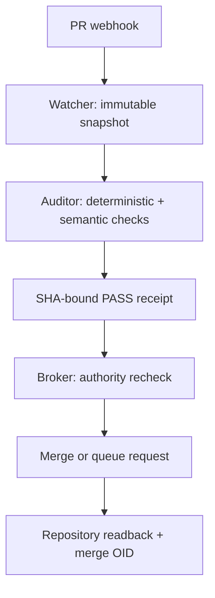

# Maintainer Agent: constitutional audit and merge broker

Project root: [MAINTAINER-AGENT-0001](https://github.com/pashamango/minutta-rp-pr-cycle-lab/issues/509)

## Boundary

The product is one operational capability, but it is not one authority. Watcher, Auditor,
and Merge Broker run with different identities and credentials. The Watcher can only
observe. The Auditor can publish a verdict for an immutable snapshot but cannot alter or
merge it. The Broker cannot generate or edit code; it only consumes a current PASS receipt,
rechecks platform gates, submits the exact expected head SHA, and verifies the merge OID.

## Trust roots

The human recovery authority owns App installation, branch rulesets, credentials, the
platform safety floor, and emergency disable. Normal automated identities have no bypass.
Changes to Maintainer Agent code, policy, workflows, CODEOWNERS, permissions, credentials,
or deployment are R3 and cannot cross the autonomous path.

## Independence test

Role names in one prompt are not separation. Production requires separate GitHub App
identities, tokens, queues, process boundaries, and logs. The PR author, auditor, and merge
identity must be pairwise distinct. A changed head, base, or policy root invalidates PASS.

## Portable layers

- `core`: provider-neutral snapshots, risk policy, receipts, and state machine.
- `github-adapter`: webhooks, checks, rules/readback, async merge, and merge queue.
- `forgejo-adapter`: equivalent provider operations without changing core semantics.
- `deployment`: environment-specific credentials, queues, receipt store, and kill switch.

Repository policies may only narrow the platform safety floor. Enrollment is explicit for
each repository and base branch. The example policy is disabled by default.

## Rollout

1. Replay historical PRs in shadow mode.
2. Publish non-blocking audit checks with no merge credential.
3. Enable R0 queue admission for one canary branch.
4. Require final OID readback and enforce an error budget.
5. Expand to R1 only after measured false-PASS and false-block performance is acceptable.

R2 remains quorum-configurable. R3 remains human/recovery-authority only.
