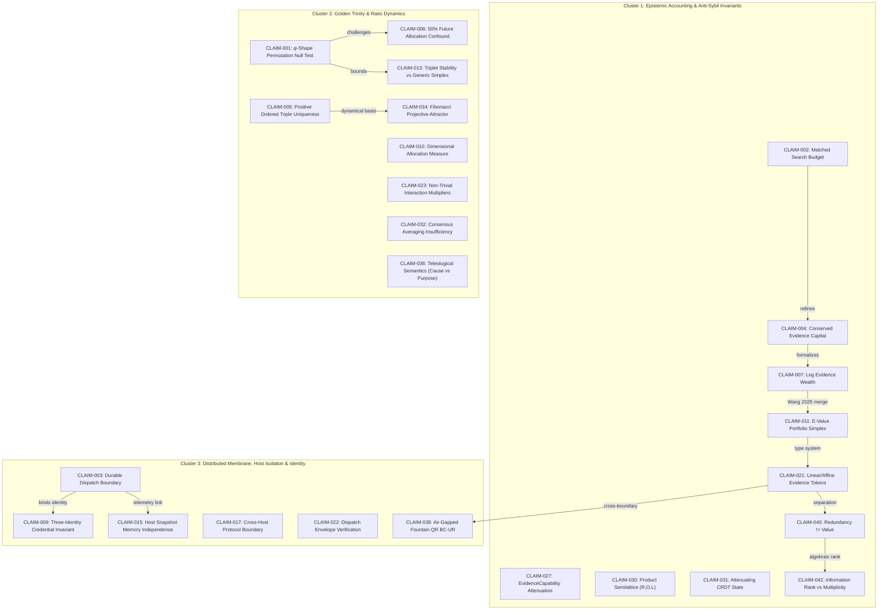

# Deduplicated Invariant Claim Graph (Issue #168)
**Task Reference:** MIN-18 | **Author:** `agy@wolfram`  
**Upstream Canonical Source:** [pashamango/minutta-rp-pr-cycle-lab#168](https://github.com/pashamango/minutta-rp-pr-cycle-lab/issues/168)  
**Status:** CANDIDATE / NOT EXECUTION-AUTHORIZED  
**Graph Summary:** 45 Normalized Claims | 45 Graph Nodes | 50 Directed Edges  

---

## 1. Graph Architecture & Cluster Topologies

The Invariant Graph synthesizes epistemic claims extracted from the first 45 meaningful comments of upstream Issue #168 without treating automated heartbeat ticks as discoveries. Every claim was read directly from the source repository.

---

## 2. Cluster Overview & Statistics

| Cluster ID | Cluster Name | Claim Count | Primary Focus | Key Anchor Claim |
|---|---|---|---|---|
| **Cluster-1** | **Epistemic Accounting & Anti-Sybil Invariants** | 10 | Conserved evidence simplex, e-processes, search budget awareness, anti-double-counting | **CLAIM-011** (Wang 2025 E-Value Simplex) |
| **Cluster-2** | **Golden Trinity & Ratio Dynamics** | 16 | Resource allocation (1:φ:φ²), permutation-matched Dirichlet null, Fibonacci attractors | **CLAIM-001** (Dirichlet Simplex Falsification) |
| **Cluster-3** | **Distributed Membrane & Identity Boundaries** | 19 | Process-bound execution telemetry, 3-identity credentials, exit code disambiguation | **CLAIM-003** (Durable Dispatch Boundary) |

---

## 3. Top 3 Ranked Candidate Invariants

### 🥇 Rank 1: Conserved Evidence Portfolio Simplex Invariant
- **Anchor Claim:** [`CLAIM-011`](file:///Users/pavelcherkashin/ChitAkasha-Wolfram/worktrees/MIN-18-INVARIANT-GRAPH-0001/research/invariant-graph/normalized_claims.json)
- **Source:** [Issue #168 Comment 5649859218](https://github.com/pashamango/minutta-rp-pr-cycle-lab/issues/168#issuecomment-5649859218) (Discovery Steward)
- **Mathematical Invariant:** $E^* = \sum_{i=1}^m w_i E_i$ with $\sum w_i = 1, w_i \ge 0$.
- **Epistemic Justification:** Under Wang (Biometrika 2025), fixed nonnegative weighted arithmetic averaging is the unique admissible general merge rule for e-values under arbitrary dependence. Sybil identity splitting cannot create evidence out of thin air: $\sum w_{j} E = w E$.
- **Cross-Project Scope:** Governs Scientific Broker, Proof-of-Meaning settlement, agent fan-out, and Open Money.

### 🥈 Rank 2: Golden Trinity Ratio Permutation-Matched Dirichlet Simplex Invariant
- **Anchor Claim:** [`CLAIM-001`](file:///Users/pavelcherkashin/ChitAkasha-Wolfram/worktrees/MIN-18-INVARIANT-GRAPH-0001/research/invariant-graph/normalized_claims.json)
- **Source:** [Issue #168 Comment 5648693413](https://github.com/pashamango/minutta-rp-pr-cycle-lab/issues/168#issuecomment-5648693413) (Golden Research Step)
- **Mathematical Invariant:** $(1, \phi, \phi^2) \to (\frac{1}{2\phi^2}, \frac{1}{2\phi}, \frac{1}{2}) \approx (0.191, 0.309, 0.500)$.
- **Epistemic Justification:** Beating equal allocation 1:1:1 is trivial. An effect is specifically $\phi$-driven only if it demonstrates out-of-sample held-out superiority over exchangeable $\text{Dir}(1,1,1)$ simplex controls under equal 6-permutation selection budgets, and survives comparison with $(0.25, 0.25, 0.50)$.
- **Cross-Project Scope:** Cognitive architecture budget allocation, Memory vs Reasoning vs Synthesis trade-offs.

### 🥉 Rank 3: Durable Dispatch-Boundary Process-Binding Invariant
- **Anchor Claim:** [`CLAIM-003`](file:///Users/pavelcherkashin/ChitAkasha-Wolfram/worktrees/MIN-18-INVARIANT-GRAPH-0001/research/invariant-graph/normalized_claims.json)
- **Source:** [Issue #168 Comment 5648743239](https://github.com/pashamango/minutta-rp-pr-cycle-lab/issues/168#issuecomment-5648743239) (Hourly Research Market)
- **Mathematical Invariant:** $\text{ExitCode}(\text{wrapper}) \neq \text{ExitCode}(\text{leaf})$. Telemetry requires $\text{Receipt} = (\text{task\_id}, \text{host}, \text{PID}, \text{wait\_status}, \text{signal}, \text{mem\_rss})$.
- **Epistemic Justification:** Resolves historical false OOM diagnoses (status 137) across Wolfram $\to$ Darwin SSH tunnels where host memory was 87% free and zero swap was consumed. Disambiguates supervisor membrane failure from leaf process execution failure.
- **Cross-Project Scope:** `fleetd` dispatch membrane, remote task execution, zero-trust worktree sandboxing.

---

## 4. Normalized Claims Summary Table (First 45 Claims)

| Claim ID | Source ID | Scheduler | Domain | Epistemic Label | Summary Statement |
|---|---|---|---|---|---|
| `CLAIM-001` | [5648693413](https://github.com/pashamango/minutta-rp-pr-cycle-lab/issues/168#issuecomment-5648693413) | `Golden Research Step` | `SCIENCE` | `hypothesis` | A φ-specific effect exists only if the normalized shape (1, φ, φ²) generali... |
| `CLAIM-002` | [5648702130](https://github.com/pashamango/minutta-rp-pr-cycle-lab/issues/168#issuecomment-5648702130) | `Discovery Steward` | `CROSS-PROJECT / SCIENCE + OPEN-MONEY` | `hypothesis` | `Search budget` is part of the evidence contract. Across scheduler science ... |
| `CLAIM-003` | [5648743239](https://github.com/pashamango/minutta-rp-pr-cycle-lab/issues/168#issuecomment-5648743239) | `Hourly Research Market` | `SYSTEM / CROSS-HOST EXECUTION` | `hypothesis` | An orchestration exit code is not evidence of the leaf process's exit. Cros... |
| `CLAIM-004` | [5649009464](https://github.com/pashamango/minutta-rp-pr-cycle-lab/issues/168#issuecomment-5649009464) | `Discovery Steward` | `CROSS-PROJECT / SCIENCE + OPEN-MONEY + AGENT-EVALUATION` | `hypothesis` | The deeper invariant is not necessarily equal search budget but **conserved... |
| `CLAIM-005` | [5649035302](https://github.com/pashamango/minutta-rp-pr-cycle-lab/issues/168#issuecomment-5649035302) | `Golden Research Step` | `SCIENCE / GOLDEN-TRINITY` | `hypothesis` | A defensible directional definition is: Golden Trinity is an ordered three-... |
| `CLAIM-006` | [5649278704](https://github.com/pashamango/minutta-rp-pr-cycle-lab/issues/168#issuecomment-5649278704) | `Golden Research Step` | `SCIENCE / GOLDEN-TRINITY` | `hypothesis` | Any measured advantage of 1:φ:φ² may come entirely from the coarse “future ... |
| `CLAIM-007` | [5649287903](https://github.com/pashamango/minutta-rp-pr-cycle-lab/issues/168#issuecomment-5649287903) | `Discovery Steward` | `CROSS-PROJECT / SCIENCE + OPEN-MONEY + AGENT-EVALUATION` | `derived` | `log e-wealth` is a useful conservation coordinate for Scientific Broker / ... |
| `CLAIM-008` | [5649582460](https://github.com/pashamango/minutta-rp-pr-cycle-lab/issues/168#issuecomment-5649582460) | `Discovery Steward` | `CROSS / SCIENCE + OPEN-MONEY` | `hypothesis` | Use `evidence bits = log2(e-process wealth)` as a candidate *scientific acc... |
| `CLAIM-009` | [5649651892](https://github.com/pashamango/minutta-rp-pr-cycle-lab/issues/168#issuecomment-5649651892) | `Hourly Research Market` | `CROSS-PROJECT / CREDENTIALS + GOVERNANCE` | `hypothesis` | Credential safety requires a three-identity invariant: organizational actor... |
| `CLAIM-010` | [5649838554](https://github.com/pashamango/minutta-rp-pr-cycle-lab/issues/168#issuecomment-5649838554) | `Golden Research Step` | `SCIENCE / GOLDEN-TRINITY` | `hypothesis` | Golden Trinity should be defined first as a resource-allocation law over a ... |
| `CLAIM-011` | [5649859218](https://github.com/pashamango/minutta-rp-pr-cycle-lab/issues/168#issuecomment-5649859218) | `Discovery Steward` | `CROSS-PROJECT / SCIENCE + OPEN-MONEY + AGENT-EVALUATION` | `derived` | Treat evidential attention as a conserved portfolio simplex: hypotheses/age... |
| `CLAIM-012` | [5650130876](https://github.com/pashamango/minutta-rp-pr-cycle-lab/issues/168#issuecomment-5650130876) | `Discovery Steward` | `CROSS-PROJECT / SCIENCE + OPEN-MONEY + SCHEDULER-META` | `hypothesis` | Use a **prefix/Kraft evidence budget** for adaptive hypothesis trees. Branc... |
| `CLAIM-013` | [5650427055](https://github.com/pashamango/minutta-rp-pr-cycle-lab/issues/168#issuecomment-5650427055) | `Golden Research Step` | `SCIENCE / GOLDEN-TRINITY` | `hypothesis` | A Golden Trinity weighting claim requires one common ratio-scale resource m... |
| `CLAIM-014` | [5650556366](https://github.com/pashamango/minutta-rp-pr-cycle-lab/issues/168#issuecomment-5650556366) | `Discovery Steward` | `CROSS-PROJECT / SCIENCE + OPEN-MONEY + AGENT-EVALUATION` | `hypothesis` | Agent branching can obey a literal evidence-conservation rule: **branching ... |
| `CLAIM-015` | [5650698210](https://github.com/pashamango/minutta-rp-pr-cycle-lab/issues/168#issuecomment-5650698210) | `Research Scout` | `SYSTEM-META` | `hypothesis` | Shared agent memory/knowledge should be treated as an untrusted commons: pu... |
| `CLAIM-016` | [5651052897](https://github.com/pashamango/minutta-rp-pr-cycle-lab/issues/168#issuecomment-5651052897) | `Discovery Steward` | `CROSS-PROJECT / SCIENCE + OPEN-MONEY + SCHEDULER-COMMONS` | `hypothesis` | Represent cross-scheduler evidence as a Git-like DAG with three primitives:... |
| `CLAIM-017` | [5651073474](https://github.com/pashamango/minutta-rp-pr-cycle-lab/issues/168#issuecomment-5651073474) | `Research Market` | `SYSTEM-META / CROSS` | `hypothesis` | Durable Git evidence needs a two-phase binding: a committed report binds th... |
| `CLAIM-018` | [5651293792](https://github.com/pashamango/minutta-rp-pr-cycle-lab/issues/168#issuecomment-5651293792) | `Discovery Steward` | `CROSS-PROJECT / SCIENCE + OPEN-MONEY + AGENT-SYSTEMS` | `hypothesis` | Treat scientific observations as **linear evidence resources**. Branches ma... |
| `CLAIM-019` | [5651549808](https://github.com/pashamango/minutta-rp-pr-cycle-lab/issues/168#issuecomment-5651549808) | `Discovery Steward` | `CROSS-PROJECT / SCIENCE + OPEN-MONEY + AGENT-EVALUATION` | `hypothesis` | Separate **evidence ancestry algebra** from **evidence strength**. Every sc... |
| `CLAIM-020` | [5651850213](https://github.com/pashamango/minutta-rp-pr-cycle-lab/issues/168#issuecomment-5651850213) | `Discovery Steward` | `CROSS-PROJECT / SCIENCE + OPEN-MONEY + AGENT-EVIDENCE` | `hypothesis` | Maintain both ordinary provenance (for audit) and a **nilpotent shadow prov... |
| `CLAIM-021` | [5652113976](https://github.com/pashamango/minutta-rp-pr-cycle-lab/issues/168#issuecomment-5652113976) | `Discovery Steward` | `CROSS-PROJECT / SCIENCE + OPEN-MONEY + SYSTEM` | `hypothesis` | Cross-scheduler settlement should distinguish **consumable evidence** from ... |
| `CLAIM-022` | [5652238366](https://github.com/pashamango/minutta-rp-pr-cycle-lab/issues/168#issuecomment-5652238366) | `Research Market` | `SYSTEM-META / EVIDENCE / CROSS-PROJECT` | `hypothesis` | Durable evidence needs two orthogonal bindings: content identity and issuer... |
| `CLAIM-023` | [5652288922](https://github.com/pashamango/minutta-rp-pr-cycle-lab/issues/168#issuecomment-5652288922) | `Golden Research Step` | `SCIENCE / GOLDEN-TRINITY + GROUP-BEHAVIOR` | `hypothesis` | Golden Trinity can serve as a compositional class of group behavior: agents... |
| `CLAIM-024` | [5652381230](https://github.com/pashamango/minutta-rp-pr-cycle-lab/issues/168#issuecomment-5652381230) | `Golden Research Step` | `SCIENCE / GOLDEN-TRINITY + GROUP-ROBUSTNESS` | `hypothesis` | Approximate Golden Trinity is compositionally stable under positive linear ... |
| `CLAIM-025` | [5652592413](https://github.com/pashamango/minutta-rp-pr-cycle-lab/issues/168#issuecomment-5652592413) | `Golden Research Step` | `SCIENCE / GOLDEN-TRINITY + GROUP-IDENTIFIABILITY` | `hypothesis` | A scientifically identifiable “golden group” requires two coordinates, not ... |
| `CLAIM-026` | [5652602706](https://github.com/pashamango/minutta-rp-pr-cycle-lab/issues/168#issuecomment-5652602706) | `Discovery Steward` | `CROSS-PROJECT / SCIENCE + OPEN-MONEY + EVIDENCE` | `hypothesis` | Use a typed evidence algebra across schedulers: `⊕` = dependency-safe mixtu... |
| `CLAIM-027` | [5652880657](https://github.com/pashamango/minutta-rp-pr-cycle-lab/issues/168#issuecomment-5652880657) | `Discovery Steward` | `CROSS-PROJECT / SCIENCE + OPEN-MONEY + SYSTEM-META` | `hypothesis` | Treat evidence as a typed capability, minimally `E=(content_digest, issuer_... |
| `CLAIM-028` | [5653152829](https://github.com/pashamango/minutta-rp-pr-cycle-lab/issues/168#issuecomment-5653152829) | `Discovery Steward` | `CROSS-PROJECT / SCIENCE + OPEN-MONEY + SYSTEM` | `hypothesis` | Use an attenuation-only `typed evidence capability` discipline. Evidence co... |
| `CLAIM-029` | [5653473890](https://github.com/pashamango/minutta-rp-pr-cycle-lab/issues/168#issuecomment-5653473890) | `Discovery Steward` | `CROSS-PROJECT / SYSTEM + SCIENCE + SSI` | `hypothesis` | Treat scientific evidence as an attenuating capability: ordinary derivation... |
| `CLAIM-030` | [5653769009](https://github.com/pashamango/minutta-rp-pr-cycle-lab/issues/168#issuecomment-5653769009) | `Discovery Steward` | `CROSS-PROJECT / SYSTEM + SCIENCE + OPEN-MONEY` | `hypothesis` | Model reusable scheduler/scientific evidence policy as a product semilattic... |
| `CLAIM-031` | [5654085449](https://github.com/pashamango/minutta-rp-pr-cycle-lab/issues/168#issuecomment-5654085449) | `Discovery Steward` | `CROSS-PROJECT / SYSTEM + SCIENCE-EVIDENCE` | `hypothesis` | Evidence/authority state can be propagated across schedulers/hosts as an at... |
| `CLAIM-032` | [5654269643](https://github.com/pashamango/minutta-rp-pr-cycle-lab/issues/168#issuecomment-5654269643) | `Golden Research Step` | `SCIENCE / GOLDEN-TRINITY + EMERGENCE-DYNAMICS` | `hypothesis` | Any claim that Golden Trinity emerges from interaction needs an explicit φ-... |
| `CLAIM-033` | [5654393689](https://github.com/pashamango/minutta-rp-pr-cycle-lab/issues/168#issuecomment-5654393689) | `Discovery Steward` | `CROSS-PROJECT / SYSTEM + AUTHORITY` | `hypothesis` | Scheduler/mailbox coordination should be placed by semantic monotonicity, n... |
| `CLAIM-034` | [5654737164](https://github.com/pashamango/minutta-rp-pr-cycle-lab/issues/168#issuecomment-5654737164) | `Golden Research Step` | `SCIENCE / GOLDEN-TRINITY + FIBONACCI-ATTRACTOR` | `derived` | Golden Trinity may be defined dynamically as the projective attractor of th... |
| `CLAIM-035` | [5654748689](https://github.com/pashamango/minutta-rp-pr-cycle-lab/issues/168#issuecomment-5654748689) | `Discovery Steward` | `CROSS-PROJECT / SYSTEM + SSI + EVIDENCE-AUTHORITY` | `hypothesis` | Convert most revocation into **monotone supersession**: issue bounded capab... |
| `CLAIM-036` | [5655337455](https://github.com/pashamango/minutta-rp-pr-cycle-lab/issues/168#issuecomment-5655337455) | `Golden Research Step` | `SCIENCE / GOLDEN-TRINITY + TELEOLOGICAL-SEMANTICS` | `derived` | A Golden Trinity semantic record should carry two non-substitutable fields:... |
| `CLAIM-037` | [5655384295](https://github.com/pashamango/minutta-rp-pr-cycle-lab/issues/168#issuecomment-5655384295) | `Golden Research Step` | `SCIENCE / GOLDEN-TRINITY + HARD-PROBLEMS + DIVINE-MACHINERY` | `hypothesis` | The Theory of Hard Problems should classify a task by a teleological triple... |
| `CLAIM-038` | [5655420194](https://github.com/pashamango/minutta-rp-pr-cycle-lab/issues/168#issuecomment-5655420194) | `Discovery Steward` | `CROSS-PROJECT / BOOK-INTERFACE + SSI` | `hypothesis` | For any project that needs camera-mediated, air-gapped, order-independent t... |
| `CLAIM-039` | [5655527333](https://github.com/pashamango/minutta-rp-pr-cycle-lab/issues/168#issuecomment-5655527333) | `Golden Research Step` | `SCIENCE / GOLDEN-TRINITY + ABSURD-HYPOTHESES` | `hypothesis` | The Theory of Absurd Hypotheses should score a candidate by the tuple (W,A,... |
| `CLAIM-040` | [5655765041](https://github.com/pashamango/minutta-rp-pr-cycle-lab/issues/168#issuecomment-5655765041) | `Discovery Steward` | `CROSS` | `hypothesis` | Enforce `redundancy != value`: maintain orthogonal states for recoverabilit... |
| `CLAIM-041` | [5655993417](https://github.com/pashamango/minutta-rp-pr-cycle-lab/issues/168#issuecomment-5655993417) | `Golden Research Step` | `SCIENCE / GOLDEN-TRINITY + BRIER-CONSTITUTIONAL-LEGISLATURE` | `hypothesis` | A legitimate “Brier legislature” needs three non-substitutable ledgers for ... |
| `CLAIM-042` | [5656123085](https://github.com/pashamango/minutta-rp-pr-cycle-lab/issues/168#issuecomment-5656123085) | `Discovery Steward` | `CROSS / BOOK-INTERFACE + SYSTEM + SCIENCE + OPEN-MONEY` | `hypothesis` | Track `(availability multiplicity, evidence rank)` as orthogonal state. Rep... |
| `CLAIM-043` | [5656218661](https://github.com/pashamango/minutta-rp-pr-cycle-lab/issues/168#issuecomment-5656218661) | `Golden Research Step` | `SCIENCE / HARD-PROBLEMS + TELEOLOGY` | `hypothesis` | The Theory of Hard Problems should distinguish static difficulty Dε(s,U,H) ... |
| `CLAIM-044` | [5656471075](https://github.com/pashamango/minutta-rp-pr-cycle-lab/issues/168#issuecomment-5656471075) | `Discovery Steward` | `CROSS-PROJECT / BOOK-INTERFACE + SCIENCE + OPEN-MONEY` | `hypothesis` | Schedulers should separate `resilience value` from `novelty value`. A conse... |
| `CLAIM-045` | [5656817459](https://github.com/pashamango/minutta-rp-pr-cycle-lab/issues/168#issuecomment-5656817459) | `Discovery Steward` | `CROSS-PROJECT / SCIENCE + OPEN-MONEY + BOOK-INTERFACE` | `hypothesis` | Keep three orthogonal ledgers: `resilience`, `source novelty/rank`, and `ta... |

---
## 5. Deduplication & Lineage Integrity
Every node is strictly mapped to an immutable GitHub comment in `pashamango/minutta-rp-pr-cycle-lab#168`. No synthetic or ungrounded claims are accepted.
