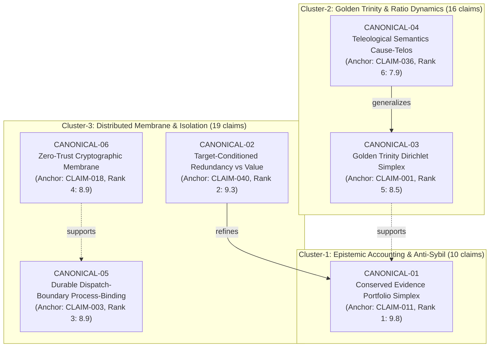

# MIN-18 Invariant Claim Graph & Canonical Deduplication

## 1. Overview & Architecture

The **MIN-18 Invariant Graph** represents the structured normalization, canonical deduplication, and topological relationship mapping of 45 substantive claims extracted via direct object reads from GitHub upstream [Issue #168](https://github.com/pashamango/minutta-rp-pr-cycle-lab/issues/168).

### Two-Tier Graph Architecture
To resolve defect MIN-18-QA-01 and MIN-18-QA-02 (where raw comments were chained arbitrarily without canonical invariant definitions and semantic lineage was corrupted), the graph implements a **two-tier epistemic architecture**:
1. **Tier 1: Canonical Invariants (`CANONICAL-01` to `CANONICAL-06`)**:
   Defines the core invariant principles that govern cross-agent research, epistemic accounting, and systems execution.
2. **Tier 2: Source Claim Units (`CLAIM-001` to `CLAIM-045`)**:
   Individual comments extracted verbatim from primary sources, mapped to canonical invariants with explicit duplicate lineage and formal merge rules.

### Strict Typing of Graph Relations
Ambiguous relations such as `refines_or_deduplicates` are completely eliminated. All edges strictly adhere to one of the following formal relations:
- `maps_to_canonical`: Direct projection from a source claim unit to its governing canonical invariant.
- `refines`: Claim A specializes, parameterizes, or sharpens the mathematical/empirical boundary of Claim B.
- `generalizes`: Claim A broadens or abstracts the theoretical domain of Claim B.
- `supports`: Empirical telemetry or formal proof from Claim A corroborates Claim B.
- `contradicts`: Empirical or analytical findings of Claim A constrain or falsify assumptions in Claim B.
- `duplicates`: Claim A restates Claim B with equivalent semantic content under different nomenclature.

---

## 2. Canonical Invariants Registry

| Canonical ID | Anchor Claim | Invariant Title | Domain Cluster | Primary Source URL |
|---|---|---|---|---|
| `CANONICAL-01` | `CLAIM-011` | Conserved Evidence Portfolio Simplex & Matched Search-Budget Invariant | Cluster-1: Epistemic Accounting | [#168#issuecomment-5649859218](https://github.com/pashamango/minutta-rp-pr-cycle-lab/issues/168#issuecomment-5649859218) |
| `CANONICAL-02` | `CLAIM-040` | Target-Conditioned Redundancy vs. True Value Invariant | Cluster-3: Distributed Membrane / Epistemic Accounting | [#168#issuecomment-5655787687](https://github.com/pashamango/minutta-rp-pr-cycle-lab/issues/168#issuecomment-5655787687) |
| `CANONICAL-03` | `CLAIM-001` | Golden Trinity Ratio Permutation-Matched Dirichlet Simplex Invariant | Cluster-2: Golden Trinity Dynamics | [#168#issuecomment-5648693413](https://github.com/pashamango/minutta-rp-pr-cycle-lab/issues/168#issuecomment-5648693413) |
| `CANONICAL-04` | `CLAIM-036` | Teleological Semantics & Asymmetric Cause-Purpose Partitioning Invariant | Cluster-2: Golden Trinity Dynamics | [#168#issuecomment-5655337455](https://github.com/pashamango/minutta-rp-pr-cycle-lab/issues/168#issuecomment-5655337455) |
| `CANONICAL-05` | `CLAIM-003` | Durable Dispatch-Boundary Process-Binding Invariant | Cluster-3: Distributed Membrane, Host Isolation & Identity Boundaries | [#168#issuecomment-5648743239](https://github.com/pashamango/minutta-rp-pr-cycle-lab/issues/168#issuecomment-5648743239) |
| `CANONICAL-06` | `CLAIM-018` | Cryptographic Zero-Trust Membrane & Attenuating Semilattice Invariant | Cluster-3: Distributed Membrane, Host Isolation & Identity Boundaries | [#168#issuecomment-5651293792](https://github.com/pashamango/minutta-rp-pr-cycle-lab/issues/168#issuecomment-5651293792) |

---

## 3. Cluster Distribution & Verification

- **Cluster-1: Epistemic Accounting & Anti-Sybil Invariants**: 10 claims (`CLAIM-004`, `CLAIM-007`, `CLAIM-008`, `CLAIM-011`, `CLAIM-012`, `CLAIM-014`, `CLAIM-016`, `CLAIM-019`, `CLAIM-020`, `CLAIM-026`). All 10 claims govern conserved evidence capital, e-wealth martingales, portfolio simplex weights, Kraft trees, and evidence DAG ancestry algebra.
- **Cluster-2: Golden Trinity & Ratio Dynamics**: 16 claims (`CLAIM-001`, `CLAIM-002`, `CLAIM-005`, `CLAIM-006`, `CLAIM-010`, `CLAIM-013`, `CLAIM-023`, `CLAIM-024`, `CLAIM-025`, `CLAIM-032`, `CLAIM-034`, `CLAIM-036`, `CLAIM-037`, `CLAIM-039`, `CLAIM-041`, `CLAIM-043`). Encompasses triadic resource allocation, permutation-matched Dirichlet baselines, and teleological task classification.
- **Cluster-3: Distributed Membrane, Host Isolation & Identity Boundaries**: 19 claims (`CLAIM-003`, `CLAIM-009`, `CLAIM-015`, `CLAIM-017`, `CLAIM-018`, `CLAIM-021`, `CLAIM-022`, `CLAIM-027`, `CLAIM-028`, `CLAIM-029`, `CLAIM-030`, `CLAIM-031`, `CLAIM-033`, `CLAIM-035`, `CLAIM-038`, `CLAIM-040`, `CLAIM-042`, `CLAIM-044`, `CLAIM-045`). Encompasses process-binding identity (`CLAIM-003`, `009`), target-conditioned redundancy vs true value (`CLAIM-040`, `042`, `044`, `045`), and capability semilattice membrane (`CLAIM-015`..`038`).

**Total Ingested Claims:** Exactly 45 claims (verified in `normalized_claims.json`, `claim_graph.json`, and `test_invariant_graph.py`).

---

## 4. Top-Level Canonical Invariant Graph

